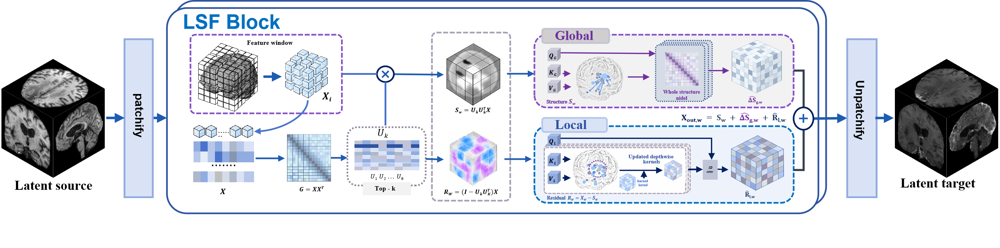
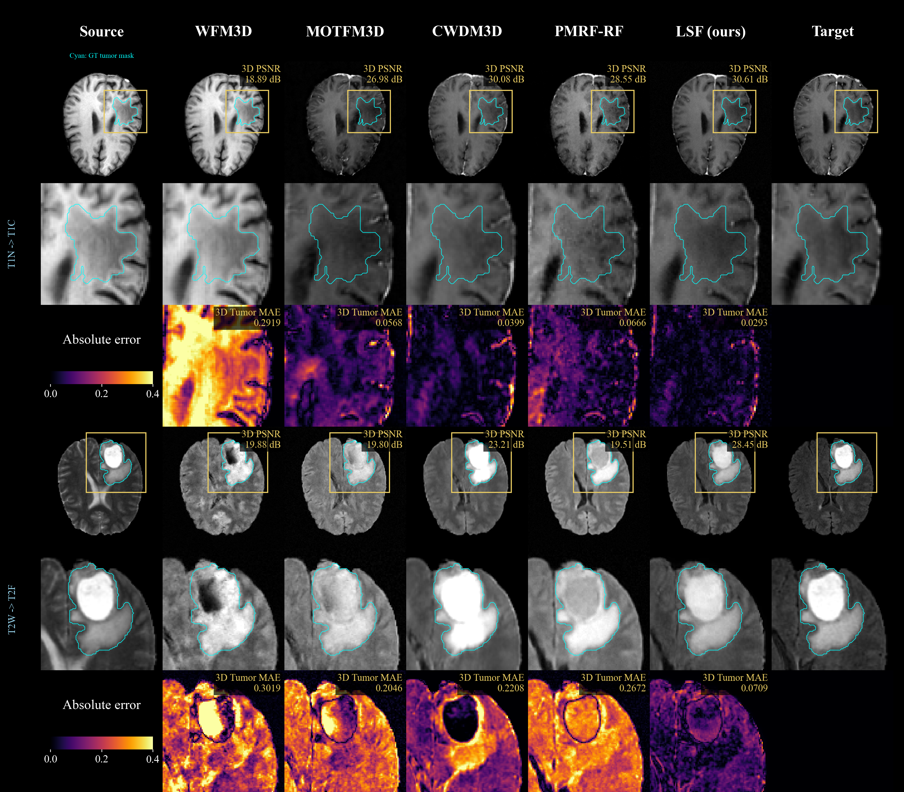
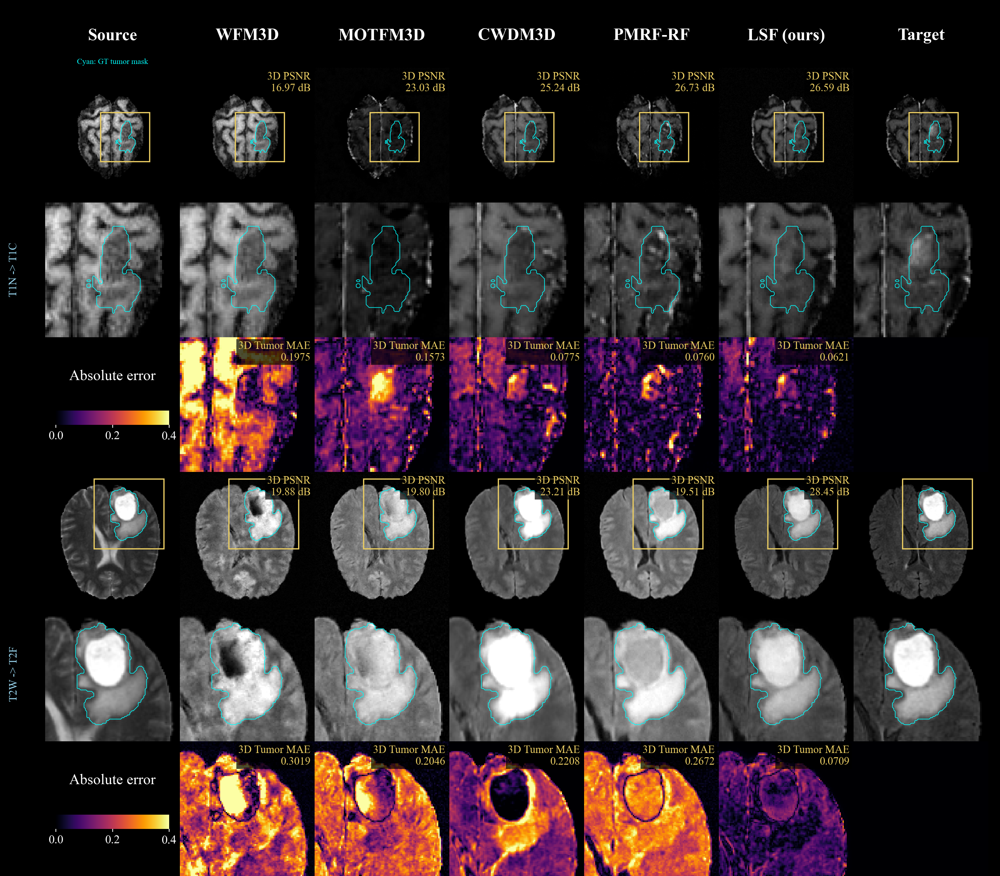
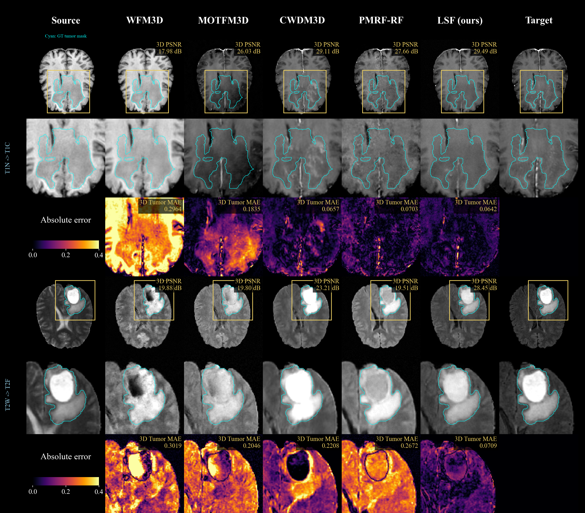
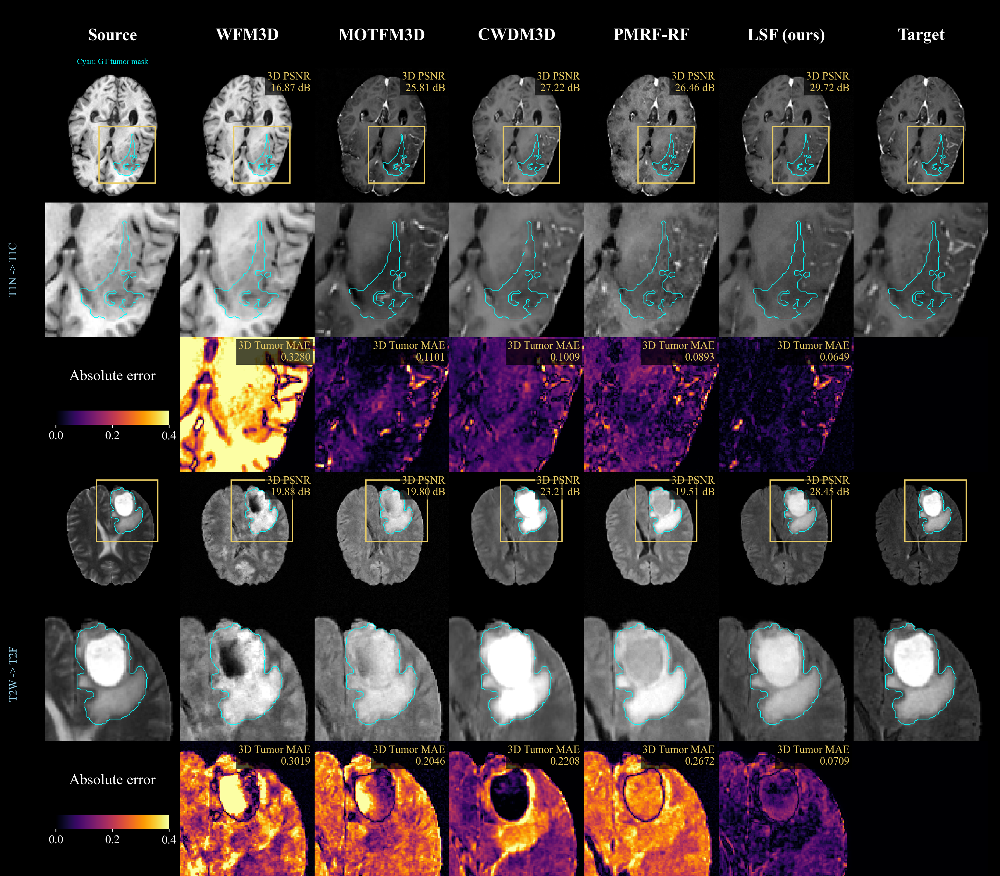
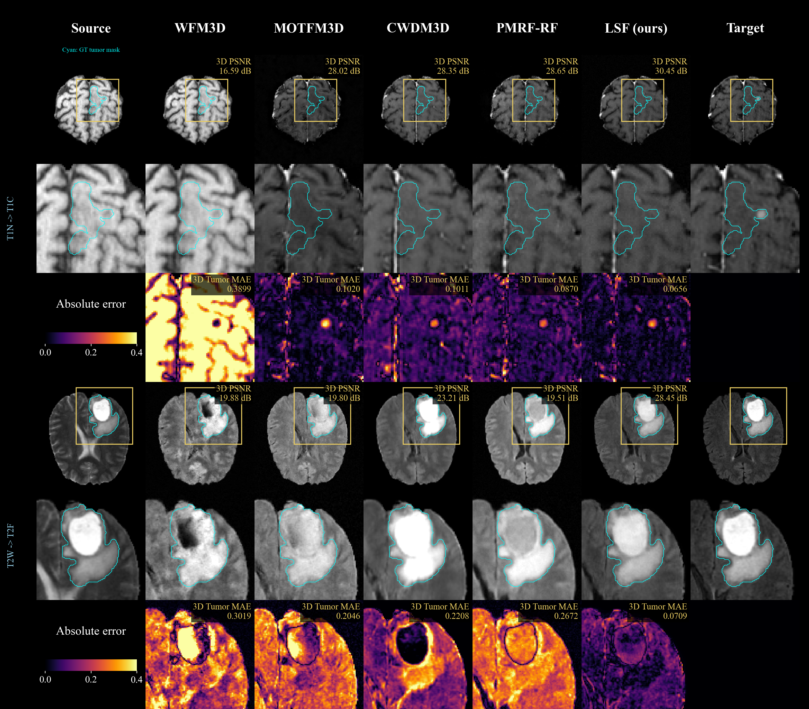
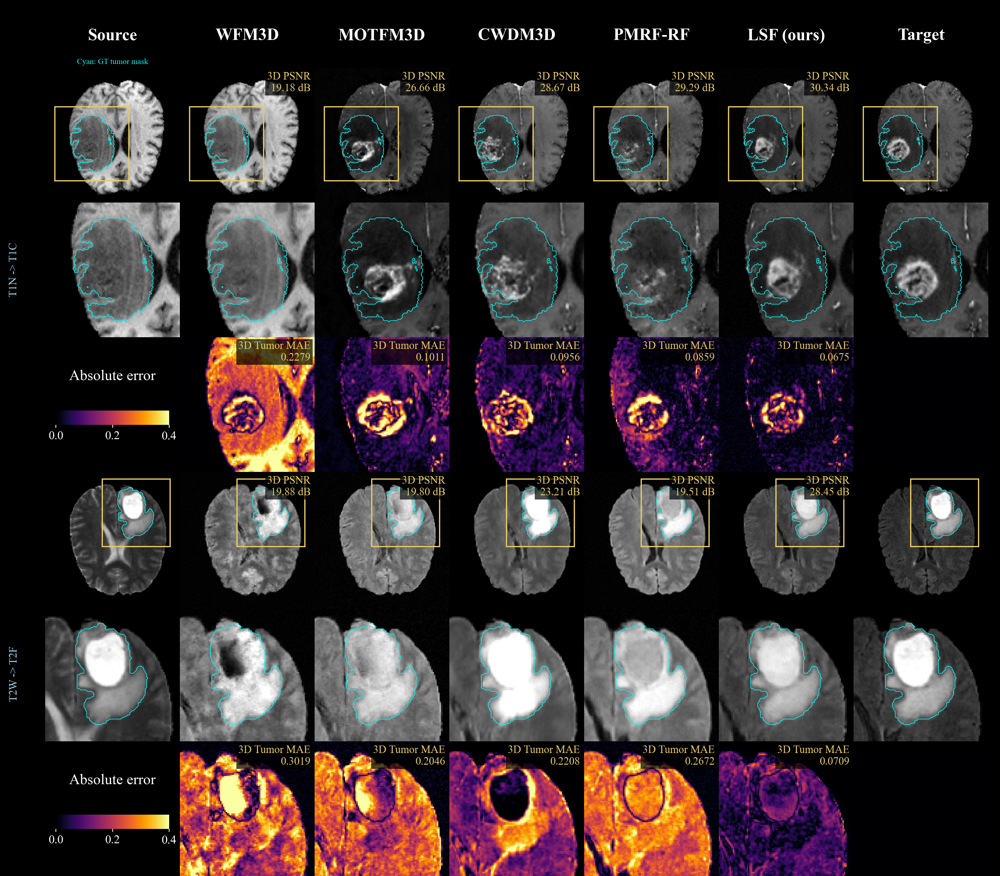
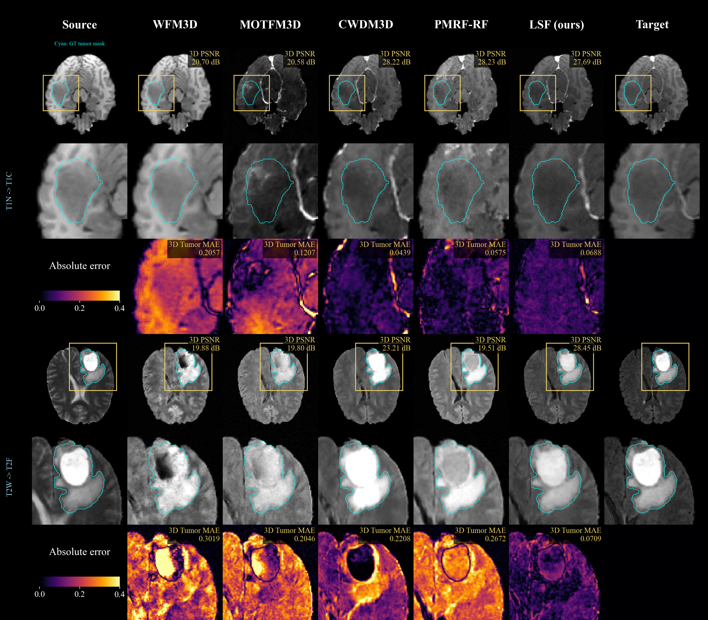
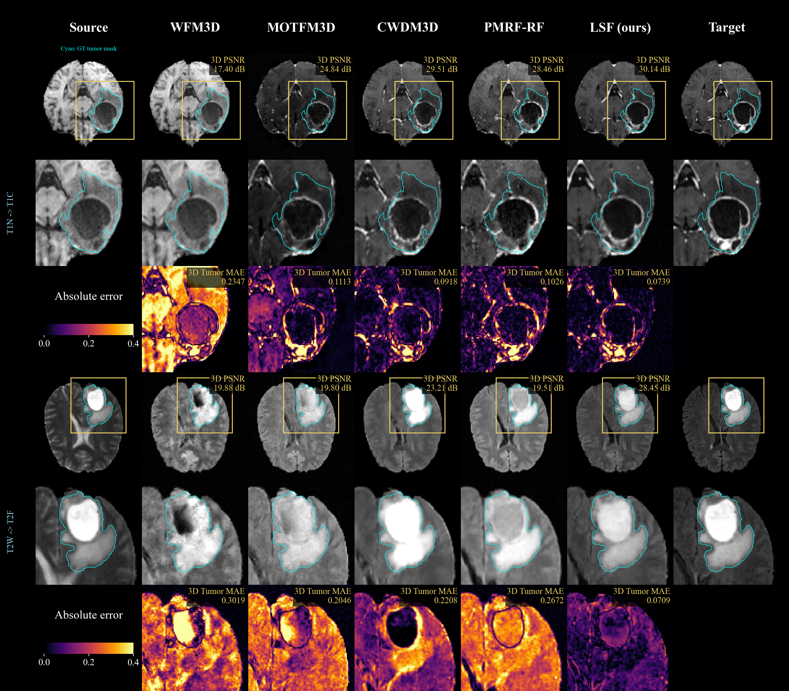
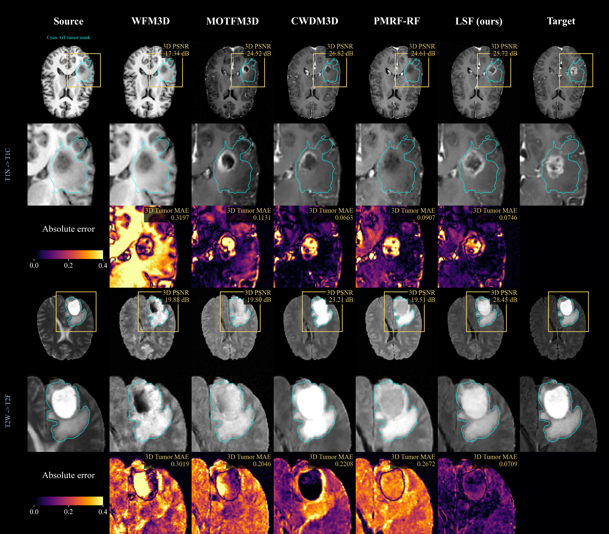

# Latent Space Is Not Flat: Rethinking Latent Structure for 3D Medical Image Synthesis

[Paper](https://arxiv.org/abs/2609.32794) · Submitted to ICASSP 2027.



> **Scope of this repository.** This code provides the generator implementation and a tested
> training/export/evaluation pipeline for the two cross-modality translation tasks. It does
> **not** currently reproduce the manuscript's latent-space analysis (§3.1, Table 1) or its
> tumour inpainting results (Tables 3–4), and it ships no external baselines or split manifests.
> Read [docs/paper_alignment.md](docs/paper_alignment.md) for the full item-by-item
> correspondence before using these numbers or settings.

## Setup

Use Python 3.10+ and CUDA-enabled PyTorch 2.5+. Run all commands from the repository root.

```bash
python -m pip install -r requirements.txt
```

## Data Preparation

Place the paired H5 datasets at:

- T1N-to-T1C: `data/h5/t1n__t1c_3d.h5`
- T2W-to-T2F: `data/h5/t2w__t2f_3d.h5`

Each file needs nonempty, patient-disjoint `train`, `val`, and `test` groups containing `source` and `target`
with shape `[N,1,D,H,W]`, `mask` with shape `[N,3,D,H,W]`, and `subject_id` with shape `[N]`.
Use unique, nonempty subject IDs and image/mask values within `[0,1]` (all finite).
The existing data uses volumes of size `155x256x256`.

```bash
python scripts/check_dataset.py --task t1n_t1c --scan
python scripts/download_ae.py
python -u precompute_latents.py --task t1n_t1c --device cuda --resume
```

The download script saves the autoencoder to `ae_assets/maisi_v1/autoencoder_v1.pt`.
For T2 data, use `--task t2w_t2f`. Complete precomputation before training.

## Train

```bash
python -u train.py --config configs/t1n_t1c_p4.yaml --output-dir outputs/t1_p4 --device cuda
```

Choose a T1/T2 P2/P4/P8 configuration from [configs](configs).
Repeating the same command resumes training. Use a new `--output-dir` when changing settings.

The `t1n_t1c_p*.yaml` and `t2w_t2f_p*.yaml` configurations keep the structural shortcut **off** and
use `r=8` with the split in only two blocks. That is an ablation baseline, not the proposed method.
To run the setting reported in the paper (`p=2`, `r=2`, the split in every block, the structural
shortcut on, 80 epochs at a constant learning rate, Euler with 50 steps):

```bash
python -u train.py --config configs/paper_lsf_t1n_t1c.yaml --output-dir outputs/t1_lsf --device cuda
```

Three method details are still not implemented and a run from this file is therefore **not** a
reproduction: the condition-side basis of Eq. (3), the `{1,2,4}` dilations in the local branch, and
the post-fusion RMSNorm. The built model also has 50.6 M parameters against the paper's 62.9 M. See
[docs/paper_alignment.md](docs/paper_alignment.md).

## Evaluate

After training:

```bash
python -u export_predictions.py --run-dir outputs/t1_p4 --checkpoint best --split test --output-dir evaluation/t1_p4_test --device cuda
python -u evaluate.py --task t1n_t1c --predictions evaluation/t1_p4_test/predictions_test.h5 --split test --output-dir evaluation/t1_p4_test/metrics --device cuda
```

Use the matching run directory and task for other configurations. Export restores the model settings
from the checkpoint. Choose a new export directory when predictions already exist.
For a dataset outside the default path, pass the same `--h5-path` to checking, precomputation,
training, export, and evaluation.


Two audit scripts need no data, no autoencoder and no GPU:

```bash
python scripts/param_audit.py        # account for the gap against the paper's 62.9M
python scripts/rho_s_null.py         # null distribution of the structural fraction
```

`rho_s_null.py` shows that Eq. (6) reproduces `r/K` exactly, so Table 4's 6.25 % reference is right,
while Table 1(B)'s 33–34 % at `r=8` is the value obtained when the basis is estimated from the error
itself (measured: 33.62 %) rather than from the target latent (25.00 %). The two tables use different
conventions.

Tag `v1.0.0` marks the initial public release; `v2.0.0` is the current version.

## Acknowledgements

[BraTS](https://www.synapse.org/Synapse:syn51156910),
[NVIDIA MAISI](https://github.com/NVIDIA-Medtech/NV-Generate-CTMR),
and [MONAI](https://github.com/Project-MONAI/MONAI).

<table>
<tr><td width="33%"><a href="assets/qualitative/case_01.png"></a></td><td width="33%"><a href="assets/qualitative/case_02.png"></a></td><td width="34%"><a href="assets/qualitative/case_03.png"></a></td></tr>
<tr><td width="33%"><a href="assets/qualitative/case_04.png"></a></td><td width="33%"><a href="assets/qualitative/case_05.png"></a></td><td width="34%"><a href="assets/qualitative/case_06.png"></a></td></tr>
<tr><td width="33%"><a href="assets/qualitative/case_07.png"></a></td><td width="33%"><a href="assets/qualitative/case_08.png"></a></td><td width="34%"><a href="assets/qualitative/case_09.png"></a></td></tr>
</table>
